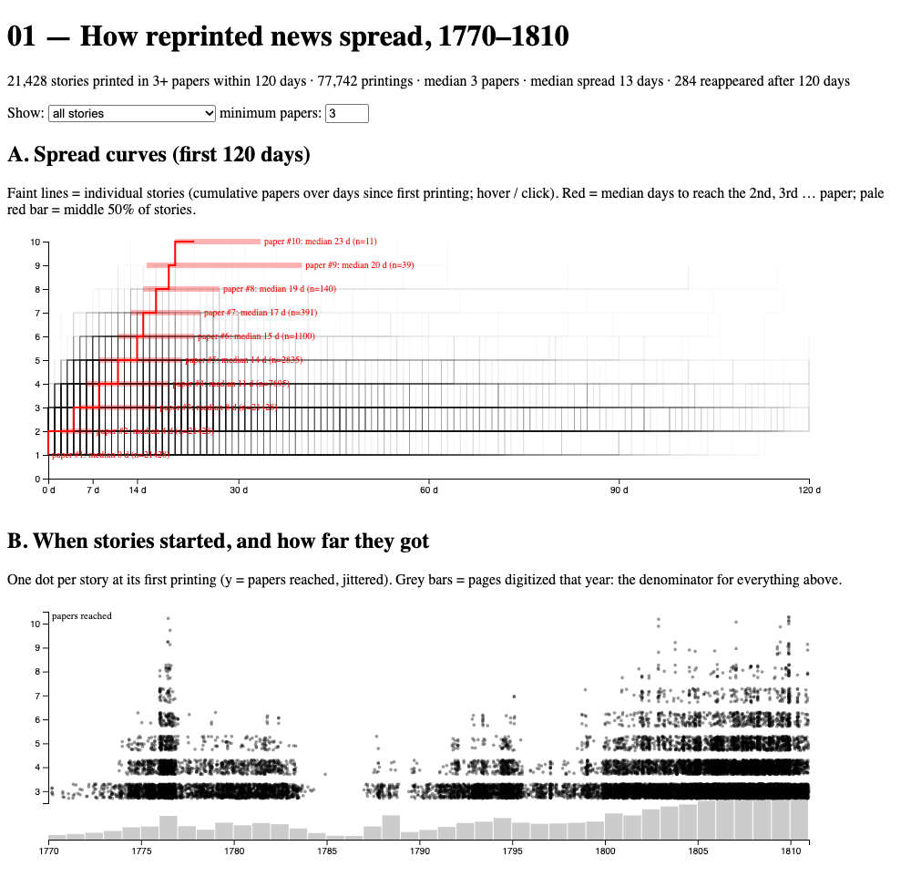
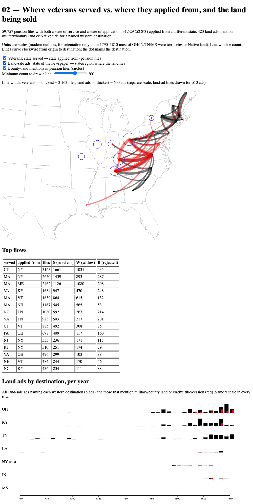
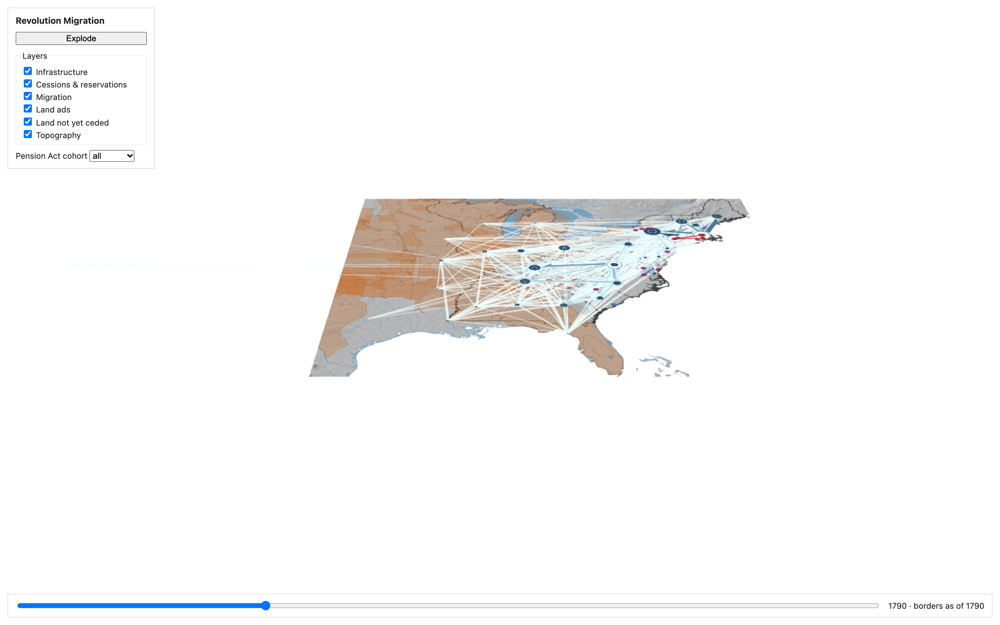
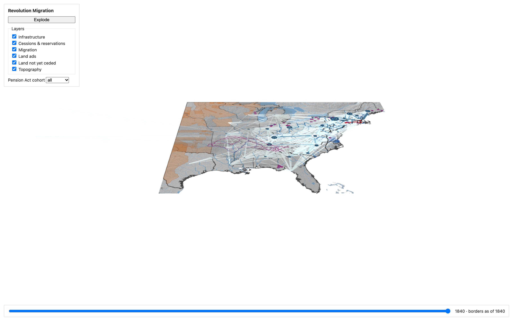
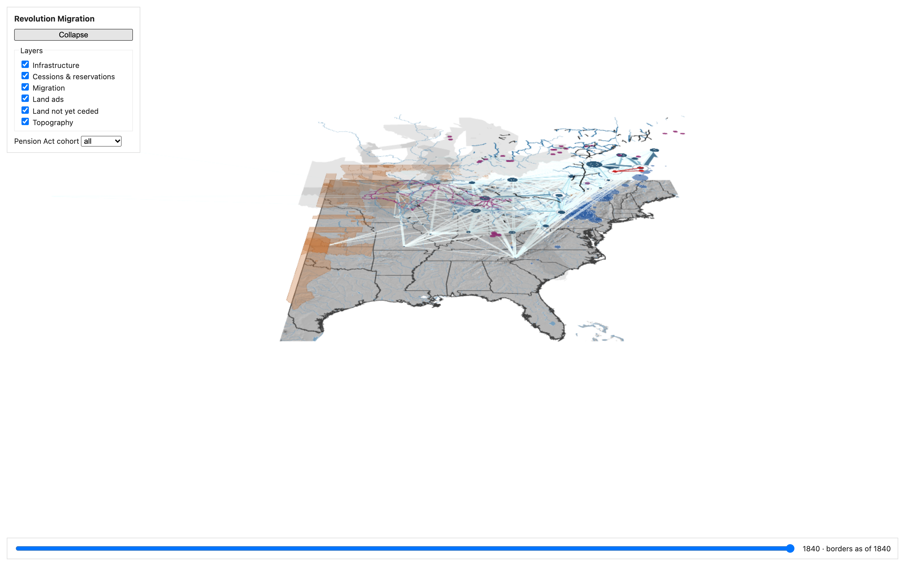
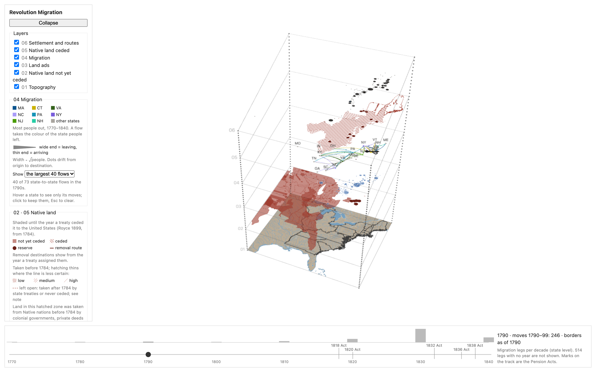
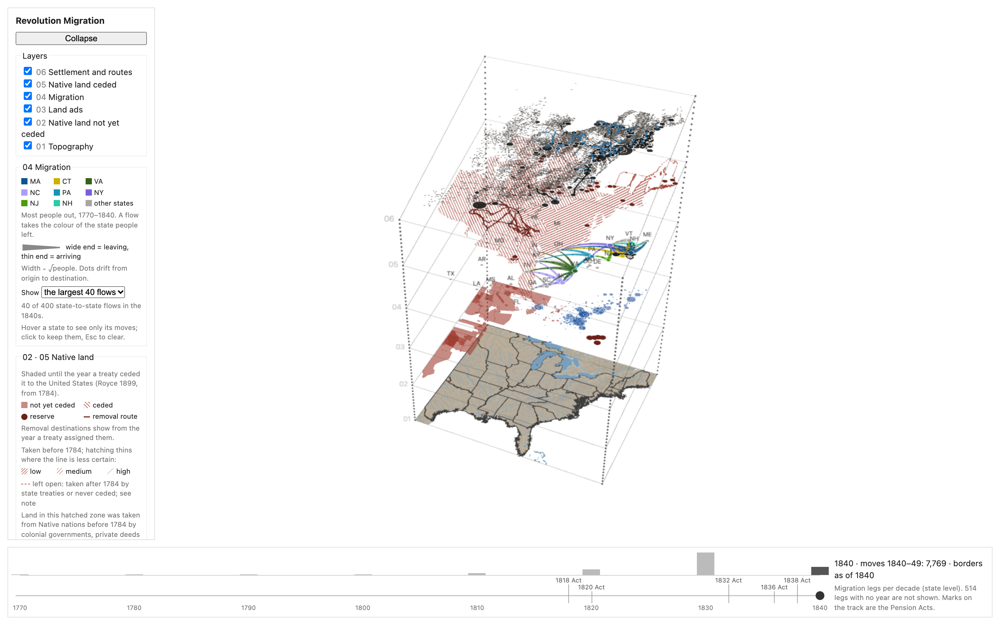
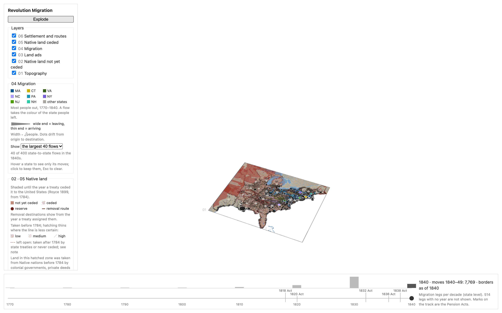

# Revolutionary Crossroads

Where did Revolutionary War veterans go after the war, and on what/whose land did they settle?
A data-visualization project mapping veterans' moves west onto ceded Native land, 1763–1840, alongside the newspaper ads that sold that land and the treaties that opened it.

Parsons School of Design, MS Data Visualization: Major Studio 1.

## Data sources

### Core: Revolution Crossroads (CC0)
From [Revolution Crossroads](https://huggingface.co/RevolutionCrossroads) on Hugging Face, queried remotely with DuckDB.

| Dataset | Size | Used for |
|---|---|---|
| NARA Revolutionary War pension files | 2.2M pages, ~78.7k files | Layer 4. The file title gives the type (S/W/R/BLW), name and service state. The declaration page gives the residence at application. |
| LoC Chronicling America, 1770–1810 | 77.8k pages, 110 papers | Layer 3. Land-sale ads by place and decade. |
| RevX OCR blocks | 19M text blocks | Layer 3. Ad text and size on the page. |
| Smithsonian collections | 12.7k objects | Cut. |

### External layers
| Layer | Source | Notes |
|---|---|---|
| 01 Topography | NOAA ETOPO 2022 relief; Natural Earth 10m rivers, lakes, coast (public domain); Newberry Library *Atlas of Historical County Boundaries* | Modern relief and water. Borders change by year (from 1783). |
| 02 Native land not yet ceded | USFS *Indian Land Cessions*, after Royce 1899 (CC BY 4.0); colonial treaty lines 1763–83 traced from treaty texts ([R11](research/R11-pre1784-lines.md)) | Royce polygons held until their cession year. Pre-1784 lines are hatched by uncertainty. |
| 05 Native land ceded | USFS Royce layer; 66 reservations ([R4](research/R4-reservations.md)); NPS Trail of Tears route (2021); 47 treaties ([R1](research/R1-treaties.md)) | NPS route is the designated trail and does not name the nation or year. |
| 06 Settlement and routes | Blevins and Helbock (2021) post offices (CC0); Gibson (1998) urban places ≥ 2,500; Atack railroads and canals (no licence stated, cited per [D-020](log/DECISIONS.md)); historic roads ([R7](research/R7-layers-history.md)) | Post offices skew to long-lived offices. Steamboat rivers dropped ([D-027](log/DECISIONS.md)). |

### Processing
Notebooks in [`rx-pipeline/`](rx-pipeline/) run raw → interim → processed. No raw Hugging Face data is stored locally; only filtered tables are saved ([D-008](log/DECISIONS.md)). The notebooks write the JSON and TopoJSON in [`web/data/`](web/data/).

Caveats and counts: [`docs/DATA.md`](docs/DATA.md). Full citations: [`research/`](research/).

## Status
Data pipeline done for v2. The web viz is in [`web/`](web/) (deck.gl, six stacked layers, decade timeline). Plan: [`docs/PLAN.md`](docs/PLAN.md).

**Milestone 4 progress update**
- Created the web visualization of isometric layers using deck.gl.
- Each layer relates to a beat to the story, and from the bottom up, each impacts the next: 
  - Topography
  - Pre-revolution native terriories
  - Newspaper land ads
  - Migration of veterans and widows based on pension applications (showing by state)
  - Native land cessions and reservations
  - Settlements (towns with over 2500+) and infrastructure (railroads and traderoutes)
- Timeline slider across the bottom to see the effect over time, binned by decades, with Pension Acts noted to correspond with the increase in data. 
- Legend on the left needs refinement.

**TODO**
- Design & UX, more interactivity, better clicks for the layers and hiding the others.
- Improve tooltip function & legend
- Map migration to counties and cities where possible (currently shows by state). 
- Audit all agent researched data and verify sources. Write disclaimers for native land terriories lines drawn. 
- Look at combining all native land as a single layer. Remove current moire pattern. 

## Prototypes

### Sketches (Oct 2026)
Early sketches to explore the data, built by Claude ([D-002](log/DECISIONS.md)).

| How reprinted news spread | Where veterans served vs. applied from, and land for sale | Weather in print vs. in memory |
|---|---|---|
|  |  |  |

Code: [`prototypes/code/`](prototypes/code/).

### v1 web viz (23 Nov 2026)
First deck.gl version, coded by Lara with coaching (commit `aaa1b12`). Flat map by default, six layers, Pension Act cohort filter, decade slider.

| 1790, flat | 1840, flat | 1840, exploded |
|---|---|---|
|  |  |  |

### v2 web viz (24 Nov 2026, current)
Exploded stack by default with numbered planes, migration flows coloured by origin state, pre-1784 treaty zone, settlements, and a timeline with migration counts and Pension Act marks.

| 1790, exploded | 1840, exploded | 1840, collapsed |
|---|---|---|
|  |  |  |

## AI use
Built with Claude Code and Claude Opus 5.5. Details are in [`AI-USE.md`](AI-USE.md): agents, approval gates and the models used.
Decisions and why: [`log/DECISIONS.md`](log/DECISIONS.md) · Prompts and agent briefs: [`log/PROMPTS.md`](log/PROMPTS.md) · Decision map: [`diagram/decisions.mmd`](diagram/decisions.mmd)

## Structure
```
web/          deck.gl viz (src/, data/)
rx-pipeline/  data notebooks and helpers
docs/         plan, data notes
research/     sourced research (treaties, GIS layers, settlements)
tasks/        agent task specs
log/          decisions, prompts, agent briefs
diagram/      decision input/output map
prototypes/   sketches, v1 and v2 screenshots, sketch code
.claude/      agent and hook config
data/         local only (git-ignored)
```
## Progress questions (2026-11-10)
Exploratory findings, not yet verified. Plan: [`docs/PLAN.md`](docs/PLAN.md).

**What data are you using, and how have you selected or processed it?**
- Core: NARA pension files (HF): 2.2M pages, ~78.7k files. The title gives the file type (S/W/R/BLW), name and service state; the declaration page gives the residence at application.
- Land ads: Chronicling America 1770–1810 (77.8k pages, 110 papers), plus OCR blocks for ad text and size.
- External: Newberry historical borders, 66 reservations (R4), Royce cession polygons, 47 treaties (R1).
- Cut: Smithsonian collections, pension PDFs.
- Processing: DuckDB queries HF remotely and saves only filtered tables ([D-008](log/DECISIONS.md)). Notebooks run raw → interim → processed. Every signal keeps a `method` and a `snippet`.

**What patterns, relationships, or interesting findings have you discovered so far?**
- 59,757 files have both a service state and a residence state; 52.8% applied from another state.
- Top flows: CT/MA → NY, VA → KY, NC → TN, VA → TN, PA/NJ → OH.
- 22,435 land-sale ad blocks: 519 military/bounty, 99 Native title/cession.
- Virginia papers selling OH/TN/KY land dominate. Military-land ads cluster in 1795–1810.
- ~22k files mention bounty land.
- Dark Day (1780): 0 newspaper hits, 117 pension files, where it is used to date marriages and births.

**Can qualitative information, such as personal accounts, provide context for your findings?**
- Pension files are first-person accounts: declarations, widows' proof of marriage, Bible pages, witness statements.
- Workstream C will extract keywords and themes from them.
- Limit: they were written 1818–1850s about 1775–83, shaped by each Pension Act's proof rules.
- Native voices are absent from these datasets. R3 ([`research/R3-native-voices.md`](research/R3-native-voices.md)) is a reading list of 30 sources and a limitations note.


