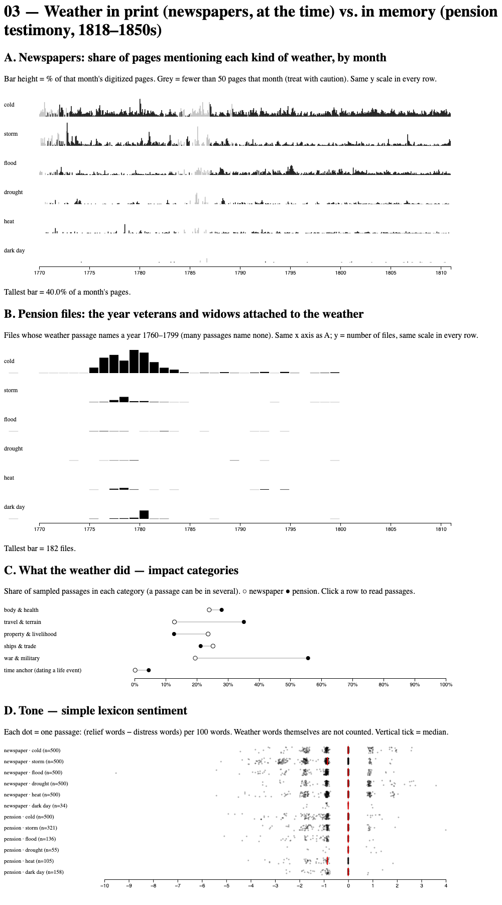

# Revolutionary Crossroads

Where did Revolutionary War veterans go after the war, and on what/whose land did they settle?
A data-visualization project mapping veterans' moves west onto ceded Native land, 1763–1840, alongside the newspaper ads that sold that land and the treaties that opened it.

Parsons School of Design, MS Data Visualization: Major Studio 1.

## Data
- [Revolution Crossroads](https://huggingface.co/RevolutionCrossroads) (CC0): Revolutionary War pension files (NARA), Chronicling America newspapers 1770–1810 (LoC), Smithsonian collections, OCR and named-entity tables.
- Land cessions: USFS *Indian Land Cessions in the United States*, after Royce 1899 (CC BY 4.0).
- Historical boundaries: Newberry Library, *Atlas of Historical County Boundaries*.

Dataset notes and caveats: [`docs/DATA.md`](docs/DATA.md). Sources: [`research/`](research/).

## Status
Data pipeline in progress. Plan: [`docs/PLAN.md`](docs/PLAN.md).

## Prototypes (Oct 2026)
Early sketches to explore the data, built by Claude ([D-002](log/DECISIONS.md)).

| How reprinted news spread | Where veterans served vs. applied from, and land for sale | Weather in print vs. in memory |
|---|---|---|
|  |  |  |

Code: [`prototypes/code/`](prototypes/code/).

## AI use
Built with Claude Code and Claude Opus 5.5. Details are in [`AI-USE.md`](AI-USE.md): agents, approval gates and the models used.
Decisions and why: [`log/DECISIONS.md`](log/DECISIONS.md) · Prompts and agent briefs: [`log/PROMPTS.md`](log/PROMPTS.md) · Decision map: [`diagram/decisions.mmd`](diagram/decisions.mmd)

## Structure
```
docs/        plan, data notes
research/    sourced research (treaties, GIS layers)
log/         decisions, prompts, agent briefs
diagram/     decision input/output map
prototypes/  early sketches
.claude/     agent and hook config
data/        local only (git-ignored)
```
## Progress questions (2026-11-10)
Exploratory findings, not yet verified. Plan: [`docs/PLAN.md`](docs/PLAN.md).

**What data are you using, and how have you selected or processed it?**
- Core: NARA pension files (HF): 2.2M pages, ~78.7k files. The title gives the file type (S/W/R/BLW), name and service state; the declaration page gives the residence at application.
- Land ads: Chronicling America 1770–1810 (77.8k pages, 110 papers), plus OCR blocks for ad text and size.
- External: Newberry historical borders, 66 reservations (R4), Royce cession polygons, 47 treaties (R1).
- Cut: Smithsonian collections, pension PDFs.
- Processing: DuckDB queries HF remotely and saves only filtered tables ([D-008](log/DECISIONS.md)). Notebooks run raw → interim → processed. Every signal keeps a `method` and a `snippet`.

**What patterns, relationships, or interesting findings have you discovered so far?**
- 59,757 files have both a service state and a residence state; 52.8% applied from another state.
- Top flows: CT/MA → NY, VA → KY, NC → TN, VA → TN, PA/NJ → OH.
- 22,435 land-sale ad blocks: 519 military/bounty, 99 Native title/cession.
- Virginia papers selling OH/TN/KY land dominate. Military-land ads cluster in 1795–1810.
- ~22k files mention bounty land.
- Dark Day (1780): 0 newspaper hits, 117 pension files, where it is used to date marriages and births.

**Can qualitative information, such as personal accounts, provide context for your findings?**
- Pension files are first-person accounts: declarations, widows' proof of marriage, Bible pages, witness statements.
- Workstream C will extract keywords and themes from them.
- Limit: they were written 1818–1850s about 1775–83, shaped by each Pension Act's proof rules.
- Native voices are absent from these datasets. R3 ([`research/R3-native-voices.md`](research/R3-native-voices.md)) is a reading list of 30 sources and a limitations note.

**What charts, graphs, or custom visualizations have you started to develop?**
- Prototypes (D3): state flow map, top-flows table, land ads by destination; side sketches on news reprints and weather.
- v1 (matplotlib, in progress):
  - flow map on 1820/1832 Newberry borders, veterans and widows shown separately;
  - top-flows table;
  - bar chart of the share applying from another state, by file type and decade;
  - reservation points by snapshot year.
- Later: land-ad frequency, prominence and run time; testimony themes; treaty timeline.

**How do your initial visualizations connect to the story you want to tell?**
- Flow map: where veterans and widows moved.
- Period borders and reservations: whose land it was, and when.
- Land ads and testimony: how the land was sold and how people described their moves.
- The prototype used modern borders and flagged Native land on only 99 ads, so v1 is drawn on a historical map.

**What challenges have you encountered with the data or code, and what questions remain?**
- Residence is where someone lived when they applied (1818–1850s), not where they first moved. For widows, it is the widow's own later address.
- The ~47% and 52.8% "moved" figures conflict and need reconciling.
- OCR quality varies. Regex gives false hits ("cession" in "concession"; Snow and Frost as surnames). Lexicon sentiment is too crude.
- The newspapers skew to VA/DC/PA and to after 1795, with a gap in 1784–86. Maine was part of MA until 1820.
- Royce shapes are generalised. ~30 reservations have only a probable polygon, and 6 allotment classes can't be mapped.
- Block types and page sizes need checking before ad prominence can be measured.
- Open:
  - What are each signal's precision and coverage?
  - Which model, if any, should handle themes and sentiment?
  - Do ad peaks line up with treaty dates and arrival waves?
